---

# Component Selection — Automated Laundry Folding Device

**Individual Subsystem:** Motor-driven folding flap, switch, LED indicator and garment presence sensing.

**Note:** Component choices are preliminary because the final folding flap dimensions, weight, and electrical power requirements have not yet been determined. The target component budget is $60.

## 1. DC Gearmotor

*Table 1: DC Gearmotor Comparison*

| **Solution** | **Pros** | **Cons** |
| --- | --- | --- |
| 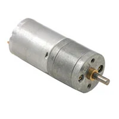 **Option 1:** Pololu 3230 — 12 V, 100 RPM, 25D **$29.95/each** [View Pololu 3230 on DigiKey](https://www.digikey.com/en/products/detail/pololu-corporation/3230/10450096) | &#8226; Operates at 12 V, matching the proposed motor power supply. &#8226; Geared output provides reduced rotational speed. &#8226; Compact 25D motor design with a 4 mm shaft. | &#8226; More expensive than the selected alternative. &#8226; Output torque has not yet been verified for the folding flap. &#8226; Does not include an encoder for position feedback. |
| 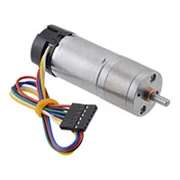 **Option 2:** Pololu 4847 — 12 V, 100 RPM, Encoder **$56.95/each** [View Pololu 4847 on DigiKey](https://www.digikey.com/en/products/detail/pololu/4847/10450249) | &#8226; Integrated encoder provides rotational feedback. &#8226; Operates using a 12 V supply. &#8226; Geared output is suitable for controlled movement. | &#8226; More expensive than the other candidates. &#8226; Encoder requires additional microcontroller input connections. &#8226; Available torque still needs to be verified. |
| 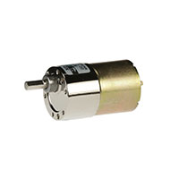 **Option 3:** DFRobot FIT0492-B — 12 V, 100 RPM Metal Gearmotor **$11.90/each** [View DFRobot FIT0492-B on DigiKey](https://www.digikey.com/en/products/detail/dfrobot/FIT0492-B/7087168) | &#8226; Significantly lower cost than the Pololu alternatives. &#8226; Operates using the proposed 12 V motor supply. &#8226; Metal gearbox provides reduced speed and increased output torque. | &#8226; Does not include an integrated encoder. &#8226; Requires a suitable mounting bracket and shaft coupling. &#8226; Starting current and stall current must be verified. |

**Choice:** Option 3 — DFRobot FIT0492-B DC Gearmotor.

**Rationale:** The DFRobot FIT0492-B provides a suitable preliminary balance of operating voltage, rotational speed, and cost for controlling one folding flap. Its 12 V operating voltage allows it to share the proposed motor power supply with the other folding mechanisms. The 100 RPM geared output can provide controlled rotational movement at a significantly lower cost than the Pololu alternatives. However, the final selection will depend on the torque required to lift the flap and clothing, the desired folding time, and the motor's current requirements.

---

## 2. H-Bridge Motor Driver

*Table 2: H-Bridge Motor Driver Comparison*

| **Solution** | **Pros** | **Cons** |
| --- | --- | --- |
| 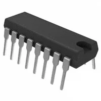 **Option 1:** STMicroelectronics L293D **$10.06/each** [View L293D on DigiKey](https://www.digikey.com/en/products/detail/stmicroelectronics/L293D/634700) | &#8226; Dual H-bridge design can control two brushed DC motors. &#8226; Through-hole DIP package simplifies prototyping and replacement. &#8226; Supports a 12 V motor supply. | &#8226; Approximately 600 mA continuous output rating may be insufficient for the selected motor. &#8226; Bipolar output transistors produce significant voltage drops and heat. &#8226; Does not provide integrated motor current sensing. |
| 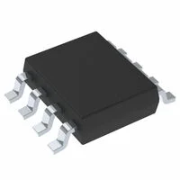 **Option 2:** Texas Instruments DRV8871DDAR **$2.98/each** [View DRV8871 on DigiKey](https://www.digikey.com/en/products/detail/texas-instruments/DRV8871DDAR/5639726) | &#8226; Supports motor supply voltages from 6.5 V to 45 V. &#8226; Integrated H-bridge provides bidirectional motor control. &#8226; Includes current regulation and protection features. | &#8226; Controls only one DC motor. &#8226; Surface-mount PowerPAD package requires careful PCB design. &#8226; Thermal performance must be checked for the motor load. |
| 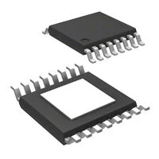 **Option 3:** Texas Instruments DRV8876PWPR **$1.95/each** [View DRV8876 on DigiKey](https://www.digikey.com/en/products/detail/texas-instruments/DRV8876PWPR/10270191) | &#8226; Supports a motor supply voltage range of 4.5 V to 37 V. &#8226; Integrated MOSFET H-bridge supports forward and reverse rotation. &#8226; Includes motor protection features and has a relatively low unit cost. | &#8226; Controls only one DC motor. &#8226; Surface-mount package requires appropriate soldering and PCB layout. &#8226; Continuous output current depends on thermal conditions. |

**Choice:** Option 3 — Texas Instruments DRV8876PWPR.

**Rationale:** The DRV8876 is a promising motor driver for controlling the folding flap because it supports bidirectional rotation. Its operating voltage range supports the proposed 12 V motor supply, while its integrated protection features are beneficial for a mechanism that may experience mechanical resistance. Its low unit cost also helps maintain the project budget. 

---

## 3. Photoresistor (LDR)

*Table 3: Photoresistor Comparison*

| **Solution** | **Pros** | **Cons** |
| --- | --- | --- |
|  **Option 1:** Advanced Photonix PDV-P8001 **$1.60/each** [View PDV-P8001 on DigiKey](https://www.digikey.com/en/products/detail/advanced-photonix/PDV-P8001/480602) | &#8226; Low-cost light-sensitive resistor. &#8226; Through-hole construction simplifies installation. &#8226; Can be connected to a microcontroller ADC using a voltage divider. | &#8226; Requires calibration for different lighting conditions. &#8226; Ambient lighting changes may cause incorrect detection. &#8226; Cannot directly distinguish clothing from other objects. |
|  **Option 2:** Advanced Photonix PDV-P8103 **$0.72/each** [View PDV-P8103 on DigiKey](https://www.digikey.com/en/products/detail/advanced-photonix/PDV-P8103/480610) | &#8226; Very inexpensive compared with the other candidates. &#8226; Through-hole leads simplify circuit assembly. &#8226; Higher resistance can reduce voltage-divider current consumption. | &#8226; Requires a voltage-divider circuit and calibration. &#8226; Readings can vary with room lighting. &#8226; Response is slower than many semiconductor optical sensors. |
| 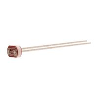 **Option 3:** Advanced Photonix PDV-P8104 **$0.90/each** [View PDV-P8104 on DigiKey](https://www.digikey.com/en/products/detail/advanced-photonix/PDV-P8104/480611) | &#8226; Low-cost light detection solution. &#8226; High resistance under low illumination conditions. &#8226; Through-hole package simplifies prototyping. | &#8226; Higher resistance circuits may be more sensitive to electrical noise. &#8226; Detection thresholds depend on ambient illumination. &#8226; Requires calibration and suitable sensor placement. |

**Choice:** Option 2 — Advanced Photonix PDV-P8103.

**Rationale:** The PDV-P8103 was selected as a secondary garment-presence detection sensor to improve the reliability of the automated folding system. When clothing is placed on the folding platform, it blocks light from reaching the photoresistor, causing a change in resistance that can be detected by the microcontroller. This provides additional confirmation that a garment is present before the folding sequence begins. Its low cost and simple circuit integration make it a practical addition to the design. However, errors may happen like normal dark room or room light turned off, triggering folding sequence. These issues must be discussed later on thoroughly to set proper light sensitivity threshold etc.
---

## 4. Weight Sensor

*Table 4: Weight Sensor Comparison*

| **Solution** | **Pros** | **Cons** |
| --- | --- | --- |
| 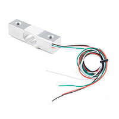 **Option 1:** SparkFun 14729 — 5 kg Load Cell **$17.81/each** [View SparkFun 14729 on DigiKey](https://www.digikey.com/en/products/detail/sparkfun-electronics/14729/9555603) | &#8226; 5 kg measurement capacity provides room for different garment weights. &#8226; Straight-bar construction can be mounted beneath a weighing platform. &#8226; Produces an electrical signal related to the applied load. | &#8226; Requires rigid and properly aligned mechanical mounting. &#8226; Produces a very small electrical output signal. &#8226; Measurement range may be larger than necessary for lightweight garments. |
| 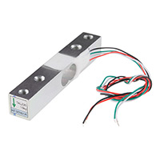 **Option 2:** SparkFun 13329 — 10 kg Load Cell **$15.15/each** [View SparkFun 13329 on DigiKey](https://www.digikey.com/en/products/detail/sparkfun-electronics/13329/7393715) | &#8226; Higher load capacity supports heavier objects. &#8226; Compact design may suit localized force measurement. &#8226; Can measure applied force through mechanical loading. | &#8226; Higher measurement range may reduce sensitivity to lightweight clothing. &#8226; Proper contact and load alignment are required. &#8226; Requires calibration for reliable measurements. |
| 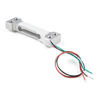 **Option 3:** SparkFun 14728 — 0.5 kg Load Cell **$15.50/each** [View SparkFun 14728 on DigiKey](https://www.digikey.com/en/products/detail/sparkfun-electronics/14728/9555602) | &#8226; Lower measurement capacity is potentially useful for lightweight garments. &#8226; Compact sensor for small-load measurements. &#8226; Relatively affordable sensing solution. | &#8226; May overload when heavier garments are placed on the platform. &#8226; Requires appropriate mechanical mounting. &#8226; Requires calibration for accurate measurements. |

**Choice:** Option 1 — SparkFun 14729, 5 kg Load Cell.

**Rationale:** The SparkFun 14729 was selected as the primary garment-presence detection sensor for the automated laundry-folding device. When clothing is placed on the folding platform, the load cell detects the applied weight, allowing the system to determine whether a garment is present. In addition to detecting garment presence, the sensor can check whether the garment's weight falls within the machine's acceptable operating garment weight range. Its 5 kg measurement capacity provides flexibility for garments of different weights while remaining suitable for a compact sensing arrangement. The final selection will depend on the expected clothing weight, the weight of the supporting platform, and the mechanical installation. 

---

## 5. Wall Power Adapter

*Table 5: Wall Power Adapter Comparison*

| **Solution** | **Pros** | **Cons** |
| --- | --- | --- |
| 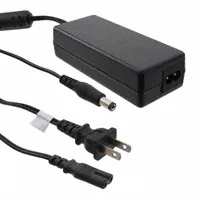 **Option 1:** Bel Power SDI65-12-UDC-P5 — 12 V, 5 A, 60 W **$47.95/each — verify price** [View Bel Power Adapter on DigiKey](https://www.digikey.com/en/products/detail/bel-power-solutions/SDI65-12-UDC-P5/5297523) | &#8226; Regulated 12 V output is compatible with the proposed motor supply. &#8226; Provides up to 5 A and 60 W of output power. &#8226; Commercial external adapter avoids designing a mains-voltage supply. | &#8226; High cost compared with the other alternatives. &#8226; Available current may be insufficient if several motors start simultaneously. &#8226; Requires compatible power connections. |
|  **Option 2:** Seeed 110061506 — 12 V, 2 A, 24 W **$8.90/each** [View Seeed Adapter on DigiKey](https://www.digikey.com/en/products/detail/seeed-technology-co-ltd/110061506/21526008) | &#8226; Lowest listed price among the compared adapters. &#8226; Provides a regulated 12 V output. &#8226; Compact external power supply. | &#8226; Limited to 2 A output current. &#8226; European plug configuration is unsuitable for direct use with standard U.S. outlets. &#8226; May not provide sufficient current for multiple motors. |
| 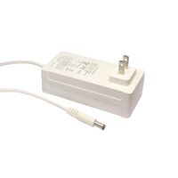 **Option 3:** Supirit ZF120A-1205000 — 12 V, 5 A, 60 W **$16.60/each** [View Supirit ZF120A-1205000 on DigiKey](https://www.digikey.com/en/products/detail/supirit-inc/ZF120A-1205000/22535301) | &#8226; Provides a regulated 12 V output with a 5 A current rating. &#8226; Integrated U.S. wall plug eliminates the need for a separate AC power cord. &#8226; Lower cost than the Bel Power alternative. &#8226; Compact wall-mounted design simplifies installation. | &#8226; Total current consumption must be verified for all three motors. &#8226; DC barrel output requires a compatible connector for power distribution. &#8226; Wall-mounted design may occupy space around adjacent electrical outlets. |

**Choice:** Option 3 — Supirit ZF120A-1205000.

**Rationale:** The Supirit ZF120A-1205000 is the preliminary choice for powering the automated laundry-folding device from a single external wall adapter. Its regulated 12 V output is compatible with the proposed DC motor power supply, while its 5 A current rating provides a potential shared power source for up to three folding motors. Unlike the other desktop-style alternatives, the Supirit adapter includes an integrated U.S. wall plug, eliminating the need to purchase a separate AC input power cord. Its $16.60 price also reduces the overall selected component cost to $48.98, keeping the project below the $60 budget target. The final selection will depend on verifying the combined operating and starting currents of the motors and other connected electronics.

---

