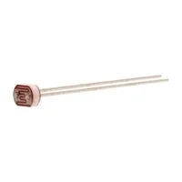
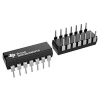
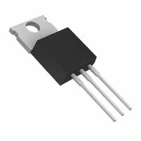
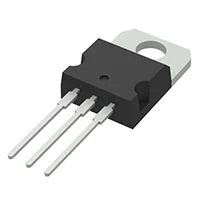
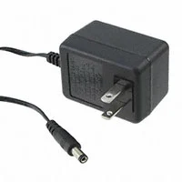
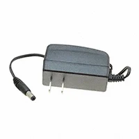

# Component Selection — Automated Laundry Folding Device

**Individual Subsystem:** Photoresistor-based garment presence sensing, operational-amplifier signal conditioning, start/stop controls, LED status indication, and regulated 5 V power supply.

## 1. Photoresistor (LDR)

*Table 1: Photoresistor Comparison*

| **Solution** | **Pros** | **Cons** |
| --- | --- | --- |
|  **Option 1:** Advanced Photonix PDV-P8001 **$1.60/each** [View PDV-P8001 on DigiKey](https://www.digikey.com/en/products/detail/advanced-photonix/PDV-P8001/480602) | &#8226; Low-cost light-sensitive resistor. &#8226; Through-hole construction simplifies installation. &#8226; Can be connected to a microcontroller ADC using a voltage divider. | &#8226; Requires calibration for different lighting conditions. &#8226; Ambient lighting changes may cause incorrect detection. &#8226; Cannot directly distinguish clothing from other objects. |
|  **Option 2:** Advanced Photonix PDV-P8103 **$0.72/each** [View PDV-P8103 on DigiKey](https://www.digikey.com/en/products/detail/advanced-photonix/PDV-P8103/480610) | &#8226; Very inexpensive compared with the other candidates. &#8226; Through-hole leads simplify circuit assembly. &#8226; Higher resistance can reduce voltage-divider current consumption. | &#8226; Requires a voltage-divider circuit and calibration. &#8226; Readings can vary with room lighting. &#8226; Response is slower than many semiconductor optical sensors. |
|  **Option 3:** Advanced Photonix PDV-P8104 **$0.90/each** [View PDV-P8104 on DigiKey](https://www.digikey.com/en/products/detail/advanced-photonix/PDV-P8104/480611) | &#8226; Low-cost light detection solution. &#8226; High resistance under low illumination conditions. &#8226; Through-hole package simplifies prototyping. | &#8226; Higher resistance circuits may be more sensitive to electrical noise. &#8226; Detection thresholds depend on ambient illumination. &#8226; Requires calibration and suitable sensor placement. |

**Choice:** Option 2 — Advanced Photonix PDV-P8103.

**Rationale:** The PDV-P8103 was selected because it provides an inexpensive and straightforward way to detect garment presence through changes in light intensity. Its resistance changes when clothing covers the sensor, allowing the microcontroller to detect the change through a voltage-divider circuit. Compared with the other options, it has the lowest cost at $0.72 and provides sufficient functionality for our application. Its through-hole design also makes prototyping and PCB integration easier.

 
---

## 2. Operational Amplifier

*Table 2: Operational Amplifier Comparison*

| **Solution** | **Pros** | **Cons** |
| --- | --- | --- |
|  **Option 1:** Texas Instruments LM324N — Quad Operational Amplifier, 14-PDIP **$0.58/each** [View LM324N on DigiKey](https://www.digikey.com/en/products/detail/texas-instruments/LM324N/277627) | &#8226; Four amplifier channels can support multiple analog sensing stages. &#8226; Through-hole DIP package simplifies breadboard testing and replacement. &#8226; Low cost and operates from a single 5 V supply. | &#8226; Output does not swing fully to the positive supply rail. &#8226; Higher input bias current can introduce errors with high-resistance sensor networks. &#8226; Limited output swing reduces available ADC signal range. |
|  **Option 2:** Texas Instruments LM324AN — Quad Operational Amplifier, 14-PDIP **$0.57/each** [View LM324AN on DigiKey](https://www.digikey.com/en/products/detail/texas-instruments/LM324AN/412056) | &#8226; Four independent channels accommodate buffering and active filtering. &#8226; Through-hole package suits educational prototyping. &#8226; Low unit cost and broad single-supply operating range. | &#8226; Output cannot approach the 5 V positive rail as closely as a rail-to-rail device. &#8226; Input bias current is less suitable for very high-impedance sensor signals. &#8226; No particular advantage over the existing MCP6004 circuit. |
|  **Option 3:** Microchip MCP6004-I/P — Quad Rail-to-Rail Operational Amplifier, 14-PDIP **$0.59/each** [View MCP6004-I/P on DigiKey](https://www.digikey.com/en/products/detail/microchip-technology/MCP6004-I-P/523060) | &#8226; Rail-to-rail output makes better use of the 0–5 V ADC input range. &#8226; Very low input bias current is well suited to the photoresistor voltage divider. &#8226; Four amplifier channels and a through-hole DIP package support buffering and filtering. | &#8226; Maximum supply voltage is only 6 V, so a regulated 5 V rail is required. &#8226; Limited bandwidth and slew rate make it unsuitable for high-speed signals. &#8226; Unused amplifier channels should be properly terminated or handled in the design. |

**Choice:** Option 3 — Microchip MCP6004-I/P Operational Amplifier.

**Rationale:** The MCP6004 was selected because its rail-to-rail output allows better use of the microcontroller's 0–5 V ADC range compared with the LM324 alternatives. Its low input bias current also makes it suitable for conditioning signals from the photoresistor circuit. The four amplifier channels provide flexibility for buffering and filtering, while its DIP package simplifies prototyping. Additionally, our previous laboratory experience with this component makes implementation and troubleshooting easier.

---

## 3. Voltage Regulator

*Table 3: Voltage Regulator Comparison*

| **Solution** | **Pros** | **Cons** |
| --- | --- | --- |
|  **Option 1:** onsemi MC7805CTG — Fixed 5 V Linear Regulator, TO-220 **$0.99/each** [View MC7805CTG on DigiKey](https://www.digikey.com/en/products/detail/onsemi/MC7805CTG/919341) | &#8226; Fixed 5 V output works with the sensor and microcontroller electronics. &#8226; TO-220 through-hole package is straightforward to mount. &#8226; Includes thermal and short-circuit protection. | &#8226; Linear regulation wastes the voltage difference as heat. &#8226; May require a heat sink at higher load currents. &#8226; Does not offer the exact selected regulator part number used in the schematic. |
|  **Option 2:** Texas Instruments LM2940CT-5.0/LF01 — Fixed 5 V Low-Dropout Regulator **$2.18/each** [View LM2940CT-5.0/LF01 on DigiKey](https://www.digikey.com/en/products/detail/texas-instruments/LM2940CT-5-0-LF01/3640899) | &#8226; Low-dropout architecture can maintain regulation with less input headroom. &#8226; Fixed 5 V output supports the logic and analog circuit. &#8226; Includes protection features for abnormal conditions. | &#8226; More expensive than standard 7805 regulators. &#8226; Still dissipates heat when reducing 9 V to 5 V. &#8226; Requires careful verification of output capacitor requirements and footprint. |
|  **Option 3:** STMicroelectronics L7805ABV-DG — Fixed 5 V Linear Regulator, TO-220 **$1.53/each** [View L7805ABV-DG on DigiKey](https://www.digikey.com/en/products/detail/stmicroelectronics/L7805ABV-DG/3945936) | &#8226; Converts the proposed 9 V adapter input to the required regulated 5 V rail. &#8226; Through-hole TO-220 package matches the intended schematic implementation. &#8226; Fixed output, thermal shutdown, and short-circuit protection simplify power design. | &#8226; Power is lost as heat because it is a linear regulator. &#8226; Available current depends on temperature and heat dissipation. &#8226; Input and output bypass capacitors and correct pin orientation are required. |

**Choice:** Option 3 — STMicroelectronics L7805ABV-DG Voltage Regulator.

**Rationale:** The L7805ABV-DG was selected because it provides a stable 5 V output from our 9 V adapter, which is necessary for reliable microcontroller and sensor operation. Unlike the more expensive LM2940 low-dropout regulator, the L7805 is sufficient because our 9 V supply provides adequate voltage headroom. Its through-hole package makes assembly straightforward, and its built-in thermal and short-circuit protection improves reliability. The preliminary power budget also indicates that a linear regulator is practical for our relatively low-power subsystem.

---

## 4. Wall Power Adapter

*Table 4: Wall Power Adapter Comparison*

| **Solution** | **Pros** | **Cons** |
| --- | --- | --- |
|  **Option 1:** Triad Magnetics WDU9-500 — 9 V, 500 mA, 4.5 W **$21.67/each** [View WDU9-500 on DigiKey](https://www.digikey.com/en/products/detail/triad-magnetics/WDU9-500/6819586) | &#8226; Provides a 9 V DC output suitable for the 5 V regulator input. &#8226; North American wall plug and center-positive 5.5 × 2.1 mm barrel connector. &#8226; External enclosed adapter avoids designing a mains-voltage supply. | &#8226; More expensive than the selected option. &#8226; 500 mA output may limit future subsystem expansion. &#8226; Connector fit and actual circuit current must still be verified. |
|  **Option 2:** Bel Power Solutions SWI12-9-N-P5 — 9 V, 1.2 A, 11 W **$16.19/each** [View SWI12-9-N-P5 on DigiKey](https://www.digikey.com/en/products/detail/bel-power-solutions/SWI12-9-N-P5/14821899) | &#8226; Higher current rating allows more flexibility for additional low-voltage electronics. &#8226; Center-positive 5.5 × 2.1 mm barrel plug and North American AC blades. &#8226; Regulated external power source with no exposed mains wiring. | &#8226; More expensive than the selected option. &#8226; Additional available current does not increase the linear regulator's thermal capability. &#8226; Barrel connector dimensions and polarity still require confirmation. |
|  **Option 3:** GlobTek WR9HD1000CCP-F(R6B) — 9 V, 1 A, 9 W **$10.35/each** [View GlobTek 9 V Adapter on DigiKey](https://www.digikey.com/en/products/detail/globtek-inc/WR9HD1000CCP-F-R6B/8598259) | &#8226; Regulated 9 V output provides sufficient input voltage for the selected L7805 regulator. &#8226; Center-positive 5.5 × 2.1 mm barrel plug and standard North American wall connection. &#8226; Compact, economical 1 A external supply provides useful current margin for the sensing subsystem. | &#8226; Barrel plug must match the selected switched jack's physical dimensions and polarity. &#8226; Wall-mounted housing can obstruct an adjacent outlet. &#8226; The downstream L7805 may require thermal management even though the adapter supports 1 A. |

**Choice:** Option 3 — GlobTek WR9HD1000CCP-F(R6B), 9 V DC Wall Power Adapter.

**Rationale:** The GlobTek adapter was selected because it provides a regulated 9 V output with a 1 A current capacity, which is sufficient for our subsystem based on the preliminary power budget. At $10.35, it is also the least expensive of the three options while offering more current capacity than the Triad adapter. Although the Bel adapter provides slightly more current, that additional capacity is unnecessary for our design. Its external wall-mounted construction also eliminates the need to build a separate AC-to-DC power supply.

