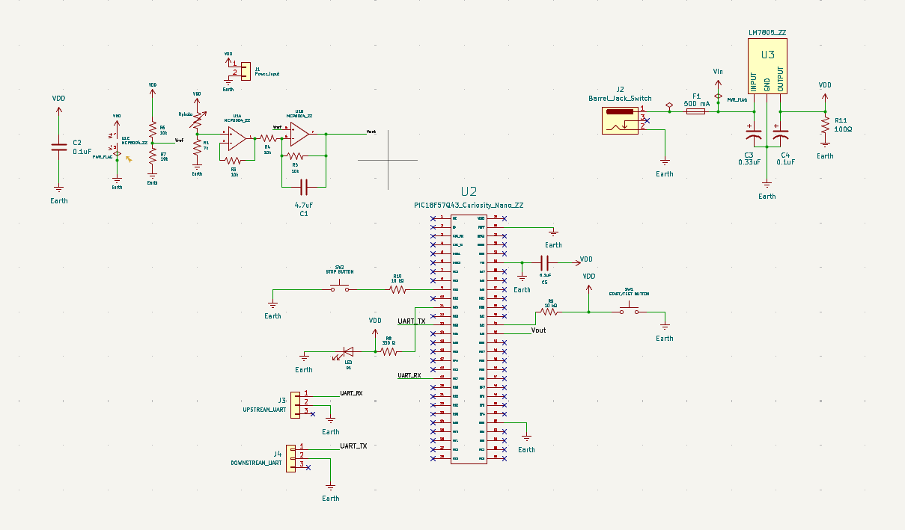
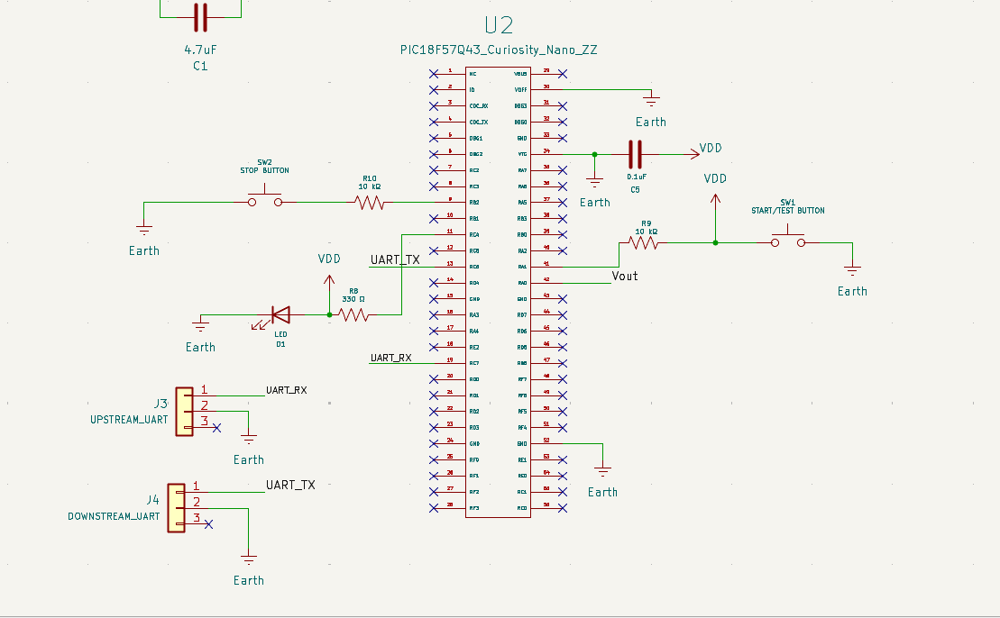
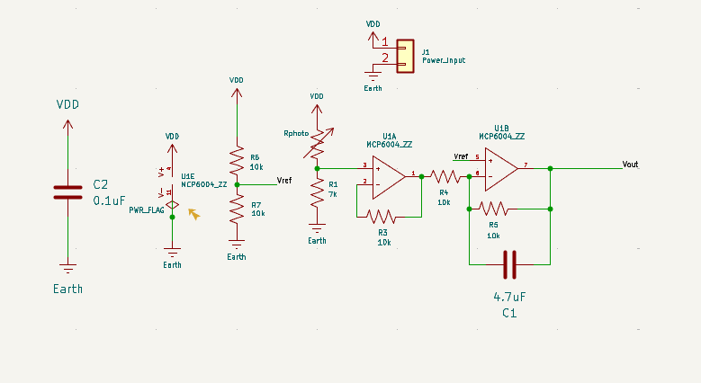
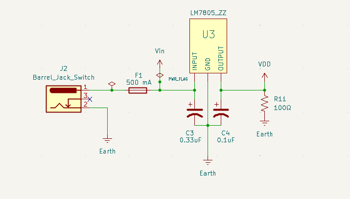

---
Individual Subsystem Schematic
---

## Overview

**Figure #1:** Complete individual subsystem schematic.

**Figure #2:** PIC18F57Q43 Curiosity Nano microcontroller connections.

**Figure #3:** Photoresistor inclusive analog sensing and signal-conditioning circuit.

**Figure #4:** Regulated 5 V power supply circuit.

## Resources

The individual subsystem schematic is available as a PDF download [**here**](files/Zarif_EGR304_Subsystem.pdf), and the complete KiCad project ZIP file is available [**here**](files/Zarif_EGR304_Subsystem%20%283%29.zip).

