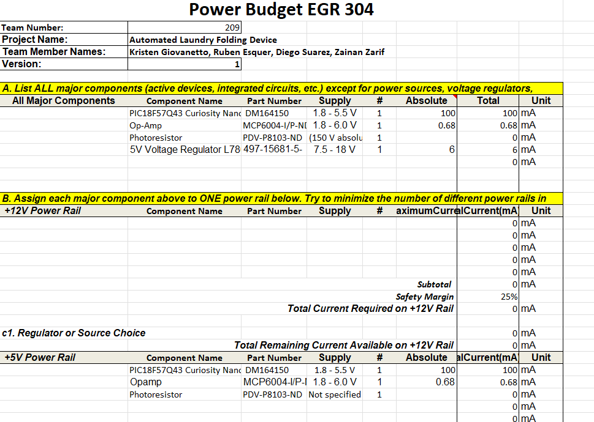
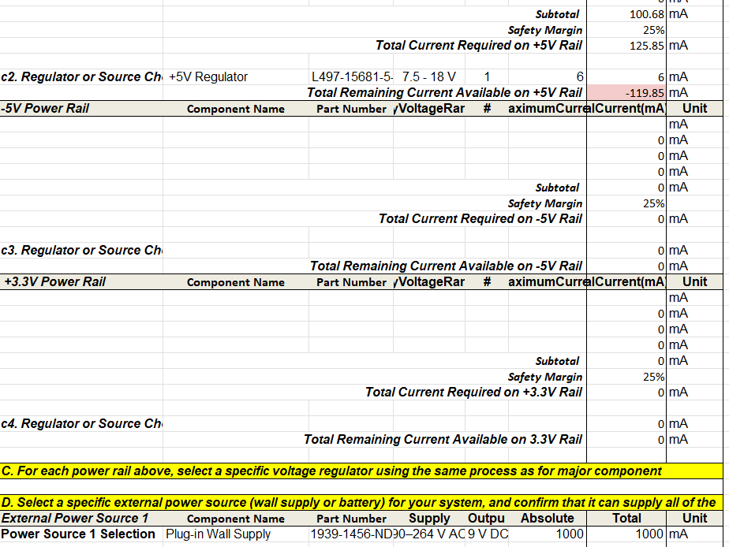
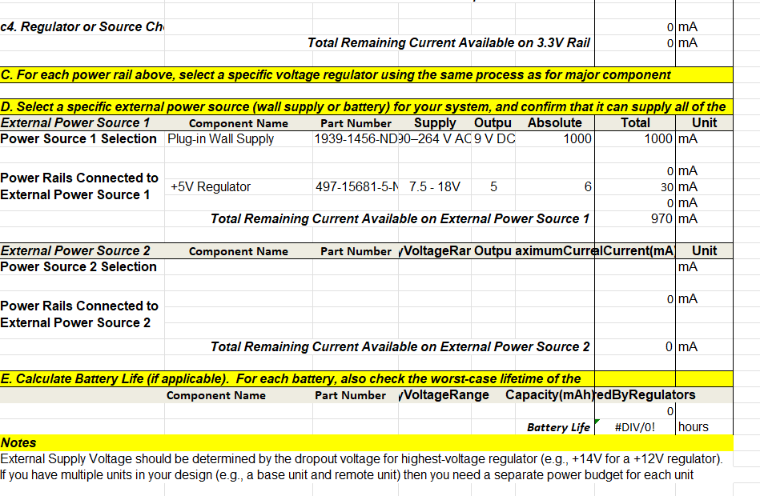

---
Power Budget Overview
---

The purpose of this power budget is to estimate the electrical power and current requirements of my EGR 304 individual subsystem. The subsystem uses a 9V DC power adapter and an L7805 voltage regulator to provide a regulated 5V supply for the PIC18F57Q43 Curiosity Nano, MCP6004 operational amplifier, and associated sensor circuitry.

The power budget helps determine whether the selected power supply can support the subsystem and provides an estimate of the total current consumption.

## Power Budget

**Figure 1:** Power budget calculations.

**Figure 2:** Continuation of power budget calculations.

**Figure 3:** Continuation of power budget calculations.

## Conclusions

Based on the preliminary power budget, the subsystem has an estimated 5V load current of approximately 100.68 mA, excluding some additional peripheral loads. With a 25% safety margin, the estimated current requirement is approximately 125.85 mA. The selected 9V, 1A power adapter provides sufficient current capacity for the estimated subsystem load. The final current consumption will be verified during hardware testing.

## Resources

The power budget files are available below:

- [Download Power Budget PDF](power_budget_files/ZARIF_POWER_BUDGET.pdf)
- [Download Power Budget Excel Spreadsheet](power_budget_files/Zarif_EGR304_PowerBudget1.xlsx)
