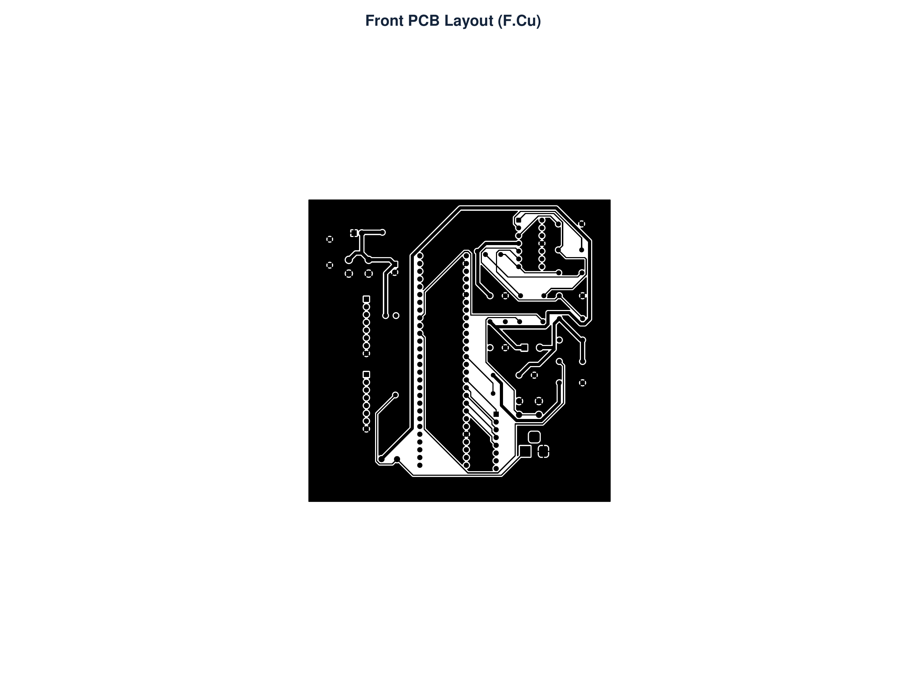
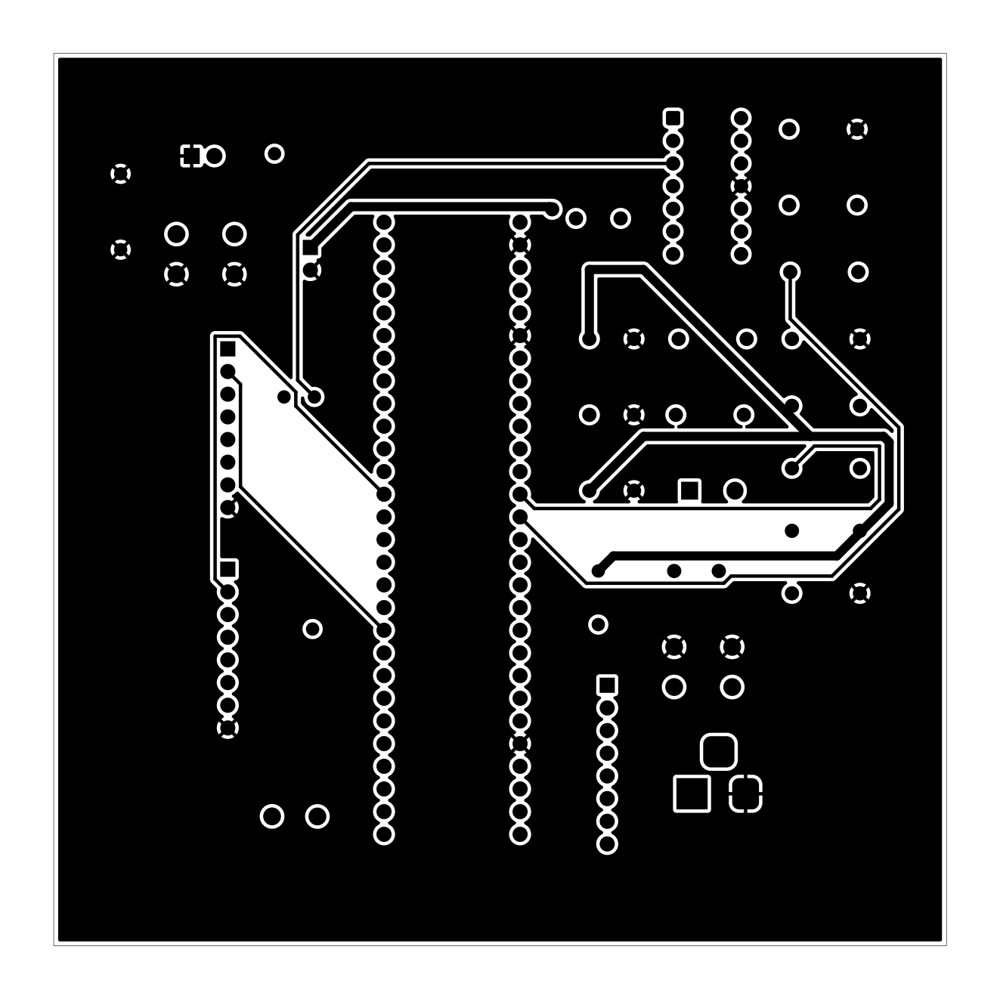
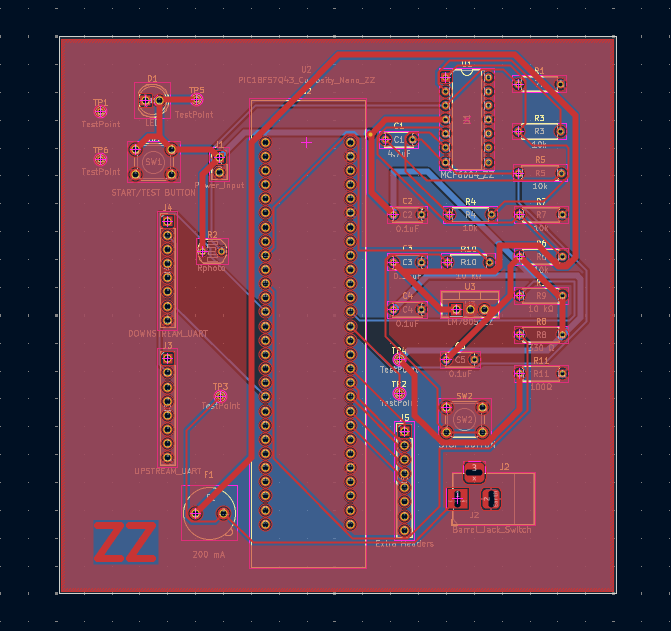

# PCB Design

## Introduction

This page documents the PCB design of my individual subsystem for the laundry folding device.

The PCB was designed using KiCad and incorporates the electronic components required for my subsystem, including the PIC18F57Q43 Curiosity Nano microcontroller, MCP6004 operational amplifier, voltage regulator, sensors, and supporting circuitry.

## PCB Specifications

| Parameter | Specification |
|-----------|---------------|
| Design Software | KiCad |
| PCB Dimensions | 100 mm x 100 mm |
| Copper Layers | 2 (Front and Back) |
| Copper Thickness | 0.5 oz/ft² |
| Power Input | 9V DC |
| Regulated Voltage | 5V DC |
| Ground Planes | Front and Back |
| Design Rules Check | Passed |

## Front PCB Layout

The front copper layer (F.Cu) contains routed electrical connections, component pads, and a copper ground plane.

**Figure 1:** Front copper layer of the individual subsystem PCB.

## Back PCB Layout

The back copper layer (B.Cu) contains additional electrical connections and a ground plane. Both copper layers are used to complete the circuit routing while maintaining required clearances.

**Figure 2:** Back copper layer of the individual subsystem PCB.

## Complete PCB Layout

The following image shows the completed PCB design in KiCad, including component placement, routed connections, copper layers, and ground planes.

**Figure 3:** Complete PCB layout showing the individual subsystem design.

## PCB Design Files

The following files contain the completed PCB layout and KiCad design project.

- [Download PCB Layout PDF](PCB_Front_Back.pdf)
- [Download Complete KiCad Project ZIP](Zarif_EGR304_Subsystem%20%288%29.zip)

## PCB Manufacturing Files

The Gerber files for PCB manufacturing were generated using KiCad and include the top and bottom copper layers, board outline, solder mask layers, silkscreen layers, and drill file.

- [Download Gerber Manufacturing Files ZIP](Zarif_PCB_209.zip)

